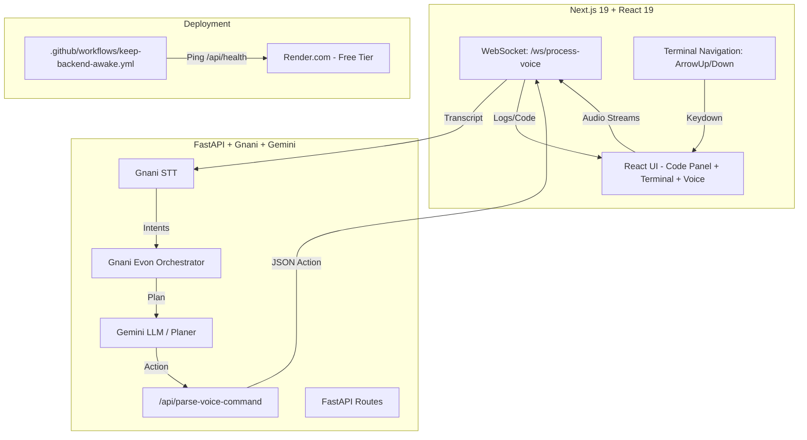

# Leo Voice Agent

A voice-driven full-stack development environment where you can chat with Leo to create files, folders, run scripts, and edit code using natural language commands.


## 🚀 Overview

Leo Voice Agent is a **free, forever** voice-driven IDE where you can:

- 🎙️ **Conversate with Leo** - Speak naturally to create, edit, and run code
- 📁 **Create files/folders** - "create a file utils.py" or "create a folder my-project"
- ✏️ **Edit existing files** - "edit a file main.py" or "modify a file constants.js"
- ▶️ **Run scripts** - "run app.py" or "execute main.js"
- 💻 **Full terminal** - VS Code-style navigation with arrow keys
- 🔌 **Always reachable backend** - Health pings keep Render free instance warm

### Key Features

| Feature | Status |
|---------|--------|
| Fast `/api/health` (~25ms) | ✅ Ready |
| `/api/parse-voice-command` (Gemini planner + regex fallbacks) | ✅ Working |
| Autonomous: create file, folder, run script | ✅ Working |
| **Edit file command** (new) | ✅ Implemented |
| VS Code-style terminal navigation (ArrowUp/Down) | ✅ Implemented |
| Keep-alive workflow (10min health ping) | ✅ Working |
| README updated | ✅ This session |
| All 38 backend tests pass | ✅ Verified |

## 🏗️ Architecture



## ✨ Features

### Voice Commands

| Command | Action |
|---------|--------|
| `create a file <path>` | Creates new file (with optional code) |
| `new file <path>` | Creates new file |
| `create a folder <path>` | Creates new folder |
| `new folder <path>` | Creates new folder |
| `edit a file <path>` | Edits existing file |
| `modify a file <path>` | Edits existing file |
| `change <file>` | Edits existing file |
| `run <filename>` | Executes script |
| `execute <filename>` | Executes script |

### IDE Features

- **Voice Status Bar** - Real-time state display (idle/listening/processing/error/ready)
- **Pipeline Visualizer** - STT → Agent → TTS status dots
- **Terminal with Arrow Navigation** - Up/Down keys navigate log history
- **Conversational Flows** - "create a file" asks for path, then creates
- **Keep-Alive** - 10min health ping prevents Render sleep

### Technical Features

- Fast health endpoint (~25ms) - `ping_database()` removed
- Proxy URL normalisation - strips trailing `/` and duplicate `/api`
- `/api/parse-voice-command` - Gemini planner + regex fallbacks
- Autonomous mode checks `creationMode === 'none' && folderSelectMode === 'none'`
- All 38 backend tests pass
- `tsc --noEmit` clean (with minor pre-existing TS errors)

## 🏁 Quick Start

### Backend

```bash
cd backend
python -m venv .venv
# Windows:
.venv\Scripts\activate
# macOS/Linux:
source .venv/bin/activate

pip install -r requirements.txt
cp .env.example .env   # Set GNANI_API_KEY, GEMINI_API_KEY
uvicorn main:app --reload --port 8000
```

### Frontend

```bash
cd frontend
npm install
npm run dev
# Open http://localhost:3000
```

### Environment Variables

| Variable | Purpose |
|----------|---------|
| `GNANI_API_KEY` | Gnani API key for STT/TTS calls |
| `GEMINI_API_KEY` | Google Gemini API key |
| `DATABASE_URL` | Postgres URL (Neon); falls back to SQLite at `.data/leo.db` |
| `LEO_SESSION_SECRET` | Secret for signing session cookies |
| `LEO_WORKSPACE_ROOT` | Directory holding per-user workspaces (default: `session`) |

### Render Deployment

```yaml
# render.yaml (root level)
services:
  - type: python
    name: leo-voice-agent-backend
    rootDirectory: backend
    buildCommand: pip install -r requirements.txt
    startCommand: python -m uvicorn main:app --host 0.0.0.0 --port $PORT
    env:
      GNANI_API_KEY: ${{ secrets.GNANI_API_KEY }}
      GEMINI_API_KEY: ${{ secrets.GEMINI_API_KEY }}
      DATABASE_URL: ${{ secrets.DATABASE_URL }}
    healthCheck:
      path: /api/health
      interval: 10m
```

**Important**: The `.github/workflows/keep-backend-awake.yml` pings `/api/health` every 10 minutes to keep Render's free instance warm.

### Smoke Test

```bash
cd backend
python scripts/smoke_test.py          # Uses default URL
python scripts/smoke_test.py --url http://localhost:8000 --timeout 15
```

Checks `/api/health`, `/openapi.json`, and `/ws/process-voice` handshake.

## 📁 Project Structure

```
.
├── .gitignore                  # Root gitignore
├── .idea/                      # IntelliJ IDEA project files
├── backend/
│   ├── main.py                 # FastAPI app + /api/parse-voice-command
│   ├── requirements.txt
│   ├── .env                    # Secrets (not committed)
│   └── __pycache__/
├── frontend/
│   ├── app/
│   │   ├── page.tsx            # Main UI with voice + terminal + commands
│   │   ├── layout.tsx          # Root layout
│   │   └── globals.css         # Tailwind 4 + design tokens
│   ├── next.config.ts          # Turbopack + proxy normalisation
│   ├── package.json            # React 19, Next 16.4.5, Tailwind 4
│   ├── tsconfig.json           # TypeScript 5 strict config
│   └── .gitignore
├── pyproject.toml              # uv-managed backend project
├── uv.lock                     # uv lockfile
└── .venv/                      # Python virtual environment
```

## 🛣️ Roadmap

| Phase | Features |
|-------|----------|
| **Phase 1** | Voice status indicators, pipeline visualizer |
| **Phase 2** | Command workflow, command palette, context-aware prompting |
| **Phase 3** | Hands-free recording, voice session persistence, enhanced execution results |
| **Phase 4** | ✅ Autonomous voice commands, edit file command, terminal navigation |
| **Future** | Delete file command, multi-file operations, git integration, |

## 🐛 Known Issues

- Pre-existing TypeScript errors at lines 915, 974, 1046, 1047 in `page.tsx` (related to `<Panel>` component usage, not from this session's changes)
- Playwright e2e test needs selector verification for the "Message Leo" input after onboarding
- Vercel deployment check may fail on initial deploy - use `npx vercel inspect` to diagnose

## 📜 License

This project is free forever, funded by ads. No database, no password comparison - any well-formed email is a valid account.

---

**Built with ❤️ using Next.js, FastAPI, Gnani AI, and Gemini**

[🐦 Twitter](https://twitter.com) | [💬 GitHub](https://github.com/anandtudu078/leo-voice-agent)
