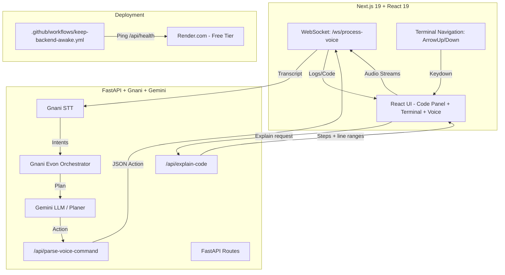

# Leo Voice Agent

A voice-driven full-stack development environment where you can chat with Leo to create files, folders, run scripts, and edit code using natural language commands.


## 🚀 Overview

Leo Voice Agent is a **free, forever** voice-driven IDE where you can:

- 🎙️ **Conversate with Leo** - Speak naturally to create, edit, and run code
- 📁 **Create files/folders** - "create a file utils.py" or "create a folder my-project"
- ✏️ **Edit existing files** - "edit a file main.py" or "modify a file constants.js"
- ▶️ **Run scripts** - "run app.py" or "execute main.js"
- 🧑‍🏫 **Learn from the code** - After Leo writes code, opt in to a line-by-line walkthrough that explains what each part does, why it was written, and the syntax/concepts used
- 💻 **Full terminal** - VS Code-style navigation with arrow keys
- 🔌 **Always reachable backend** - Health pings keep Render free instance warm

### Key Features

| Feature | Status |
|---------|--------|
| Fast `/api/health` (~25ms) | ✅ Ready |
| `/api/parse-voice-command` (Gemini planner + regex fallbacks) | ✅ Working |
| `/api/explain-code` (code/syntax walkthrough; Gemini + fallback) | ✅ Working |
| Autonomous: create file, folder, run script | ✅ Working |
| **Edit file command** | ✅ Implemented |
| **Opt-in code explanation walkthrough (v1)** | ✅ Implemented |
| **Reviewable diff edits + undo** | ✅ Implemented |
| VS Code-style terminal navigation (ArrowUp/Down) | ✅ Implemented |
| Keep-alive workflow (10min health ping) | ✅ Working |
| README updated | ✅ Updated |
| Backend tests | ✅ `pytest` (38 passing in current suite) |

## 🏗️ Architecture



## ✨ Features

### Voice Commands

| Command | Action |
|---------|--------|
| `create a file <path>` | Creates new file (with optional code) |
| `new file <path>` | Creates new file |
| `create a folder <path>` | Creates new folder |
| `new folder <path>` | Creates new folder |
| `edit a file <path>` | Edits existing file |
| `modify a file <path>` | Edits existing file |
| `change <file>` | Edits existing file |
| `run <filename>` | Executes script |
| `execute <filename>` | Executes script |

### IDE Features

- **Voice Status Bar** - Real-time state display (idle/listening/processing/error/ready)
- **Pipeline Visualizer** - STT → Agent → TTS status dots
- **Opt-in Code Explanation (v1)** - After Leo writes code, Leo asks whether to explain it; if you agree, the editor highlights code in logical chunks and explains what it does, why it was written, and the syntax/concepts used
- **Terminal with Arrow Navigation** - Up/Down keys navigate log history
- **Conversational Flows** - "create a file" asks for path, then creates
- **Keep-Alive** - 10min health ping prevents Render sleep

### Code Explanation Walkthrough (v1)

This feature is designed to help users learn the language, syntax, and programming concepts behind generated code.

1. **Agent writes code** (for example, after a voice command that creates/updates a file).
2. **Leo asks permission:** “Should I explain the code and syntax line by line?”
3. **You respond:**
   - **Yes** (button, typed message, or voice: `yes`, `explain`, `teach`, `sure`, `ok`) — Leo explains the full file step by step.
   - **No** (`no`, `skip`, `not now`, `continue`) — Leo skips the explanation and stays ready for the next command.
   - **Another command** (for example, `run it`, `create app.js`) — the explanation prompt is cancelled and Leo continues with that command.
4. **Walkthrough UI:** the editor highlights the current line range, auto-scrolls to it, and shows **What it does**, **Why we wrote it**, and **Syntax/concepts**. You can use **Prev/Next/Close** or the editor **Explain** button to review code again.

**API:** `POST /api/explain-code` accepts `{ path, code?, language?, goal? }` and returns structured steps (`startLine`, `endLine`, `title`, `what`, `why`, `syntax`, plus `provider`). Leo tries the configured primary LLM (`GEMINI` by default) and falls back to `GROQ` on retryable errors (rate limits/quota, timeouts, 5xx/overloaded) or when the primary provider is unavailable; if LLM output is unusable or no provider succeeds, it falls back to a deterministic line-based explainer (`provider: fallback`). v1 is text-only (no TTS narration yet).

### Reviewable Edits & Undo (Tier 1)

Leo never blind-writes over an existing file. When a voice or text request targets a file that is already open (or named in the request), Leo asks the model for a complete updated version, turns it into a unified diff, and sends it to the editor as a reviewable proposal.

1. **Proposal:** the file stays untouched; the editor shows the diff with added/removed line counts and a short summary.
2. **Review:** choose **Accept edit** or **Reject**, or say **“apply”** / **“reject”**. Nothing is written until you accept.
3. **Stale-write protection:** if the file changed since the proposal was generated, the edit is rejected instead of clobbering newer content.
4. **Undo:** use the **Undo** button or say **“undo that”** to restore the last applied agent edit. Each applied edit records a before/after revision in the database.

The proposal prompt includes the active file, the recent conversation, and optional selected text, so follow-ups like “make it faster” or “change line 12” work without restating the file.

**API:**

- `POST /api/agent/propose-edit` — `{ path, transcript, selection?, history? }` → `{ path, old_code, new_code, diff, summary, added, removed, changed, provider }`; writes nothing.
- `POST /api/agent/apply-edit` — `{ path, old_code, new_code, summary? }` → applies only if the file still matches `old_code` (409 otherwise).
- `POST /api/agent/undo` — `{ path? }` → restores the newest un-undone edit for that file or workspace.

WebSocket clients can also use `edit-proposal` / `edit-result` events and send `accept_edit`, `reject_edit`, or `undo_edit`.

### Technical Features

- Fast health endpoint (~25ms) - `ping_database()` removed
- Proxy URL normalisation - strips trailing `/` and duplicate `/api`
- `/api/parse-voice-command` - Gemini planner + regex fallbacks
- `/api/explain-code` - Gemini-generated structured walkthrough steps with deterministic fallback
- Autonomous mode checks `creationMode === 'none' && folderSelectMode === 'none'`
- Backend test suite: 38 passing tests (`cd backend && pytest -q`, current workspace config)
- Frontend production build / TypeScript checks pass (`cd frontend && npm run build`)

## 🏁 Quick Start

### Backend

```bash
cd backend
python -m venv .venv
# Windows:
.venv\Scripts\activate
# macOS/Linux:
source .venv/bin/activate

pip install -r requirements.txt
cp .env.example .env   # Set GNANI_API_KEY, GEMINI_API_KEY
uvicorn main:app --reload --port 8000
```

### Frontend

```bash
cd frontend
npm install
npm run dev
# Open http://localhost:3000
```

### Environment Variables

| Variable | Purpose |
|----------|---------|
| `GNANI_API_KEY` | Gnani API key for STT/TTS calls |
| `GEMINI_API_KEY` | Google Gemini API key (voice planning/replies and `/api/explain-code`) |
| `GROQ_API_KEY` | Optional Groq API key for LLM fallback |
| `GROQ_MODEL` | Groq model for fallback (default: `llama-3.3-70b-versatile`) |
| `LLM_PRIMARY` / `LLM_FALLBACK` | LLM provider order (default: `gemini` → `groq`) |
| `DATABASE_URL` | Postgres URL (Neon); falls back to SQLite at `.data/leo.db` |
| `LEO_SESSION_SECRET` | Secret for signing session cookies |
| `LEO_WORKSPACE_ROOT` | Directory holding per-user workspaces (default: `session`) |
| `GNANI_STT_LANGUAGE` | STT language code (default: `en-IN`; depends on Gnani service/model support) |

### Render Deployment

```yaml
# render.yaml (root level)
services:
  - type: python
    name: leo-voice-agent-backend
    rootDirectory: backend
    buildCommand: pip install -r requirements.txt
    startCommand: python -m uvicorn main:app --host 0.0.0.0 --port $PORT
    env:
      GNANI_API_KEY: ${{ secrets.GNANI_API_KEY }}
      GEMINI_API_KEY: ${{ secrets.GEMINI_API_KEY }}
      DATABASE_URL: ${{ secrets.DATABASE_URL }}
    healthCheck:
      path: /api/health
      interval: 10m
```

**Important**: The `.github/workflows/keep-backend-awake.yml` pings `/api/health` every 10 minutes to keep Render's free instance warm.

### Smoke Test

```bash
cd backend
python scripts/smoke_test.py          # Uses default URL
python scripts/smoke_test.py --url http://localhost:8000 --timeout 15
```

Checks `/api/health`, `/openapi.json`, and `/ws/process-voice` handshake.

## 📁 Project Structure

```
.
├── .gitignore                  # Root gitignore
├── .idea/                      # IntelliJ IDEA project files
├── backend/
│   ├── main.py                 # FastAPI app (voice, file APIs, parse/explain endpoints)
│   ├── requirements.txt
│   ├── .env                    # Secrets (not committed)
│   └── __pycache__/
├── frontend/
│   ├── app/
│   │   ├── page.tsx            # Landing page
│   │   ├── code/               # Code workspace UI (editor, voice, terminal, explain walkthrough)
│   │   ├── layout.tsx          # Root layout
│   │   └── globals.css         # Tailwind 4 + IDE/landing styles
│   ├── next.config.ts          # Turbopack + proxy normalisation
│   ├── package.json            # React 19, Next 16.4.5, Tailwind 4
│   ├── tsconfig.json           # TypeScript 5 strict config
│   └── .gitignore
├── pyproject.toml              # uv-managed backend project
├── uv.lock                     # uv lockfile
└── .venv/                      # Python virtual environment
```

## 🛣️ Roadmap

| Phase | Features |
|-------|----------|
| **Phase 1** | Voice status indicators, pipeline visualizer |
| **Phase 2** | Command workflow, command palette, context-aware prompting |
| **Phase 3** | Hands-free recording, voice session persistence, enhanced execution results |
| **Phase 4** | ✅ Autonomous voice commands, edit file command, terminal navigation |
| **Phase 5** | ✅ Opt-in line-by-line code explanation walkthrough (v1, text-only) |
| **Phase 6** | ✅ Context-aware diff proposals, accept/reject review, stale-write protection, undo |
| **Future** | TTS narration for explanations, language-aware/AST chunking, explanation tests, delete file command, multi-file operations, git integration |

## 🐛 Known Issues

- Playwright e2e test needs selector verification for the "Message Leo" input after onboarding
- Vercel deployment check may fail on initial deploy - use `npx vercel inspect` to diagnose
- The sandbox runs scripts non-interactively (`stdin` is not connected). For learning demos that use `input()`, Leo should prefer CLI args/default values; the explanation fallback notes this limitation.
- Voice transcription is configured by default for `en-IN` (`GNANI_STT_LANGUAGE`); broader spoken-language support depends on the configured Gnani STT service/model and app configuration.

## 📜 License

This project is free forever, funded by ads. No database, no password comparison - any well-formed email is a valid account.

---

**Built with ❤️ using Next.js, FastAPI, Gnani AI, and Gemini**

[🐦 Twitter](https://twitter.com) | [💬 GitHub](https://github.com/anandtudu078/leo-voice-agent)
